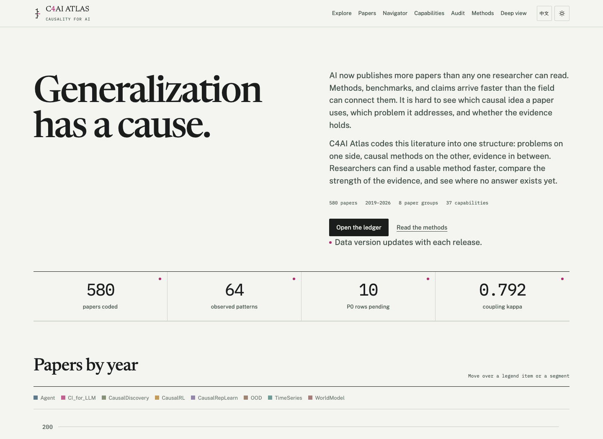
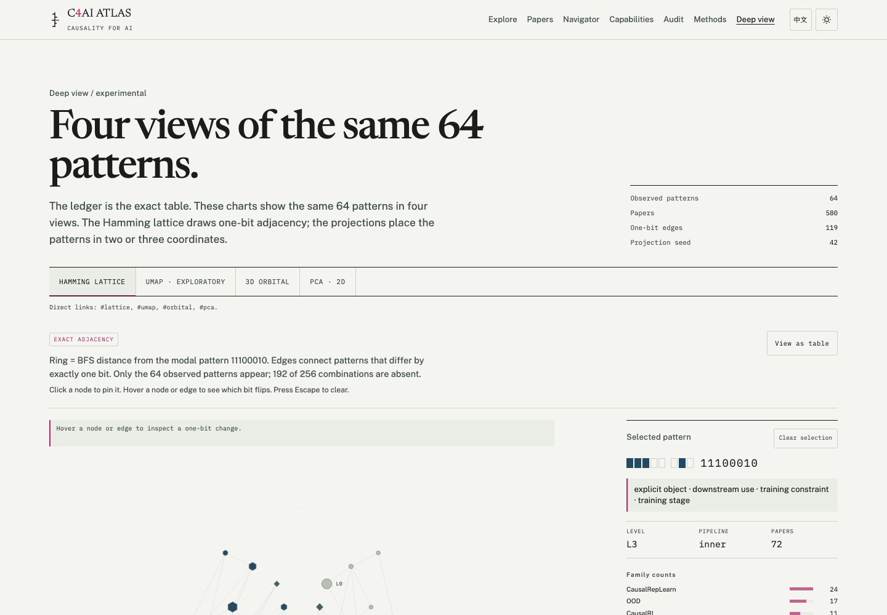
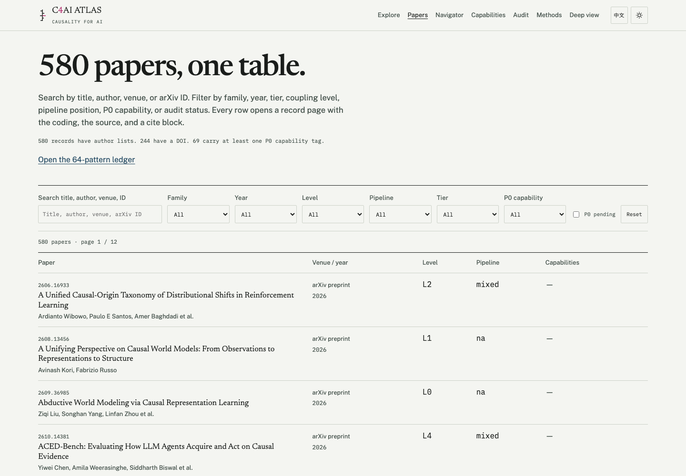
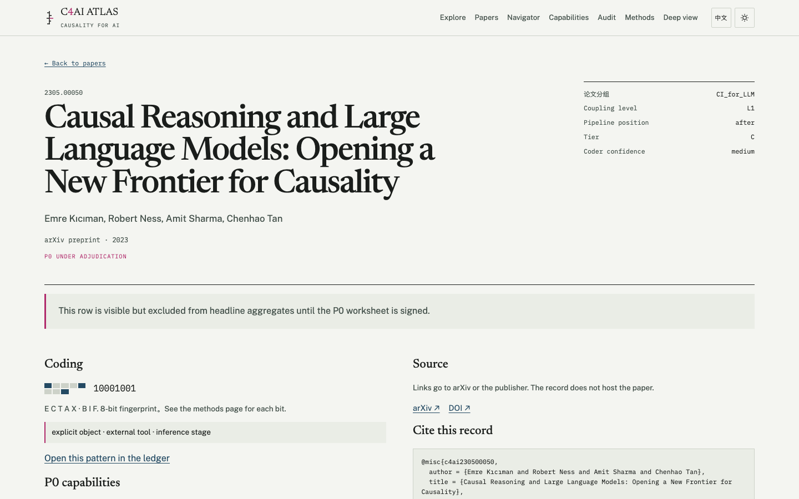

# C4AI Atlas

**Generalization has a cause.** A coded, searchable map of 580 papers on causality for AI.

This repository is the website. It ships a static data snapshot. It does not host PDFs, abstracts, or publisher figures.

Live site: **https://levinpaulino.github.io/C4AI-Atlas/**

Repository: **https://github.com/LEVINPAULINO/C4AI-Atlas**









## What is here

- 580 coded papers across eight families.
- 64 observed 8-bit coding patterns, each shown with plain-language labels.
- Home-page annual timeline with a total line and muted category bars.
- 37 causal capabilities mapped to AI lifecycle cells.
- 15 P0 capabilities with exemplars, ACL/LLM cases, negative cases, and assumptions.
- 69 papers carry at least one P0 capability tag.
- Searchable paper table plus 580 static record pages in both languages.
- A static problem navigator: 7 problem families, 15 P0 capabilities, 14 author rules, no runtime model.
- 10 P0 rows still open. They are shown with a badge and excluded from headline totals.
- Authors from arXiv, venue and DOI from arXiv/OpenAlex where available.

The default view is the Fingerprint Ledger. The Hamming lattice, UMAP projection, 3D orbital, PCA, UpSet, and parallel coordinates are deeper views.

## Quickstart

```bash
npm install
npm run dev
```

Build the static site:

```bash
npm run build
```

Preview the build:

```bash
npm run preview
```

## Data

The public snapshot is committed:

```text
public/atlas/v1/atlas.json
public/atlas/v1/manifest.json
public/atlas/v1/layouts.json
public/atlas/v1/navigator.json
public/atlas/v1/README.md
```

`navigator.json` is a derived pilot file for `/navigator/`. It is not part of the frozen snapshot hash and carries author mappings, not problem-level evidence.

There is no API. The files are versioned and immutable for a release. `manifest.json` carries the version, counts, and SHA-256.

`npm run build:data` rebuilds the snapshot from the analysis workspace. It is not needed for deployment.

`npm run build:layouts` recomputes PCA and UMAP coordinates. It needs `python3 -m venv .venv` and `pip install -r scripts/requirements-layouts.txt`.

## Problem navigator

`/navigator/` is a static pilot. The reader picks a problem family, data type, intervention condition, and confounding status. A client-side rule engine returns candidate capabilities with assumptions, failure modes, a minimal test, and capability-level exemplars.

The rules are author mappings, not learned recommendations. Evidence is attached at the capability level; problem-level evidence has not been coded. The page does not call a model, does not rank methods by an invented score, and does not claim a measured effect. Combinations with no corpus evidence are shown as gaps. P0 records under adjudication are excluded from the evidence lists.

Rebuild the pilot data from the atlas:

```bash
python3 scripts/build_navigator.py
```

## Deployment

GitHub Actions builds and deploys to GitHub Pages. The workflow sets `SITE_BASE` to the repository name.

No custom domain is configured. The site lives at:

```text
https://levinpaulino.github.io/C4AI-Atlas/
```

The first deploy needs three repository settings:

1. Push the contents of this `site/` directory to the repository root.
2. Open **Settings → Pages** and set **Source** to **GitHub Actions**.
3. Push to `main`. The workflow in `.github/workflows/pages.yml` runs the type check, builds with `SITE_BASE=/C4AI-Atlas/`, and deploys `dist/`.

Step-by-step commands and troubleshooting: [`DEPLOY.md`](DEPLOY.md).

## Design

- Day theme: Survey Blueprint.
- Night theme: Signal Room.
- Type: Newsreader, IBM Plex Mono, Public Sans, Noto Serif SC subset.
- The visual contract is in `SKILL.md`. Decisions are in `DECISIONS.md`. Team roles are in `TEAM.md`.

## Copyright

Public pages use metadata, our coding, short quotations with locators, and links. They do not include PDFs, abstracts, or publisher figures.

Quoted text remains with its authors and publishers and is excluded from this project's license. See `RESPONSIBILITY.md`.

## License

- Code: MIT.
- Annotations, codebook, and site prose: CC BY 4.0.
- Metadata: CC0 where sourced from OpenAlex, Crossref, or arXiv.
- Quoted third-party text: excluded.

See `LICENSES.md`.

## Citation

```text
C4AI Atlas contributors (2026). C4AI Atlas: a coded map of causality for AI
(v0.1.0-provisional). https://github.com/LEVINPAULINO/C4AI-Atlas
```

A version DOI will be added after the first frozen release. See `CITATION.cff`.

## Contributing

Report a data error, suggest a paper, or submit a code change with DCO sign-off. See `CONTRIBUTING.md`.

## Newsletter

The newsletter provider is not connected yet. No address is collected by the current site. For release notes, email 1991740862@qq.com.
